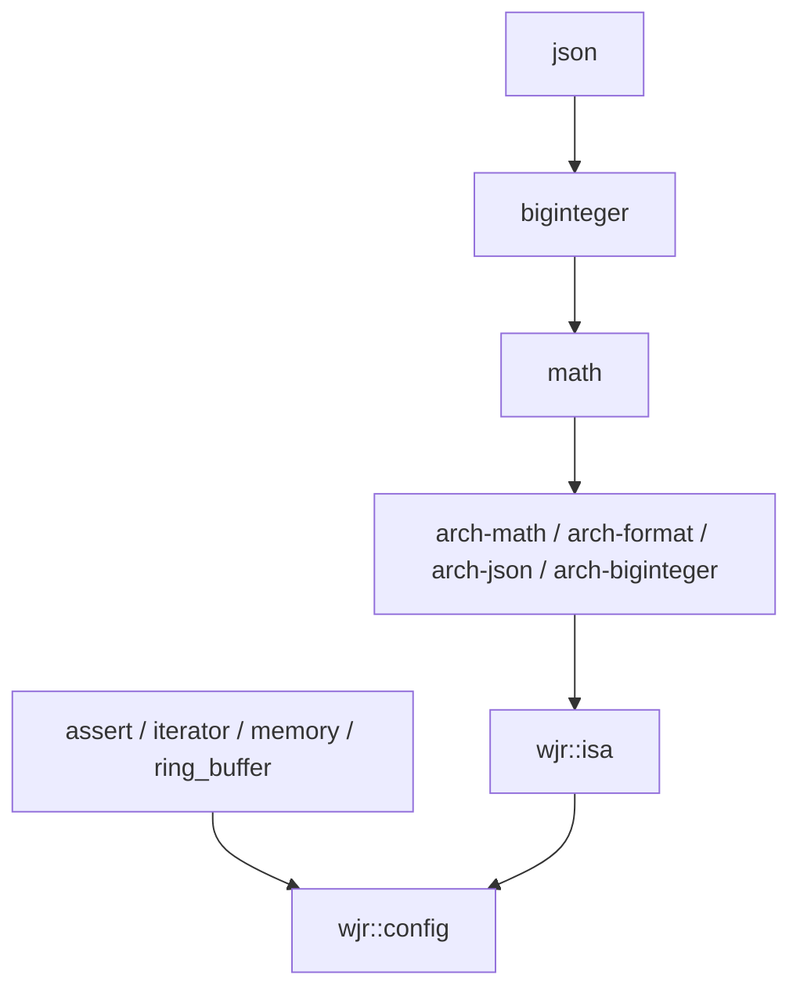

# WJR 基础架构设计

WJR 以可组合的通用 C++ 模块为基础，将数值和字节扫描内核的 ISA 要求限制在明确的依赖边界内。
0.2 的最低语言标准为 C++20，并提供 C++23 的构建验证路径。
标准升级、CPU 目标、第三方依赖和 tensor 数据模型分别管理。

## 语言标准与标准库适配

`WJR_CXX_STANDARD` 接受 `20`、`23`，默认 `20`，通过 `cxx_std_N` 传递最低语言要求。
调用方可以使用更高标准；这不等于强制所有消费者使用完全相同的编译参数。
C++17 构建和旧 `WJR_DISABLE_CXX_20=ON` 配置会明确报错，即使同时指定了 C++20。
旧开关为 `OFF` 时仍可配置，但会提示从缓存删除；已有 `WJR_CXX_STANDARD=17` 需显式更新为 `20` 或 `23`。
直接包含公共头文件也必须使用正式 C++20 或更高模式；不接受仅报告 draft C++2a 的旧编译器模式。

最低标准升级允许后续逐模块使用 concepts、`std::span`、`[[no_unique_address]]` 和常量求值设施，
降低双标准路径的维护成本；本次不批量删除兼容宏或改写热点模板。
最低编译器版本和语言模式是不同要求：CI 覆盖 GCC 11–14、Clang 17–20 和当前 Windows MSVC/Clang，
实际可用性仍取决于编译器、标准库和所需特性。升级到 C++20 本身不构成提速证据。

优先使用标准库已有设施。例如 C++20 下 `wjr::bit_cast` 直接使用具有相应
feature-test macro 的 `std::bit_cast`；缺少该标准库特性时保留已有实现。
可选标准库设施必须同时检查实际库特性，不能仅凭 `__cplusplus` 判断可用性。
C++26 暂不成为构建契约；`std::simd` 等设施需要独立验证目标编译器、标准库及生成码后接入。

普通对象的 `wjr::construct_at` 复用 C++20 `std::construct_at`，使构造可用于受支持的常量求值；
返回类型仍为 void，参数转发和条件 noexcept 保持原约定。数组及仅向 WJR 授予构造访问权的类型保留原路径。
`default_construct` 扩展继续执行默认初始化，不把标量的未初始化存储改成值初始化清零。
字节序使用 `std::endian` 检查实际目标；原数值转换只能得到 1，无法识别不支持的大端目标。
公开 endian 枚举值仍为 little=0、big=1；本轮仍只支持小端目标，未新增大端算法实现。

语法迁移以消除重复实现、改进约束和诊断或支持常量求值为目的。
对已有热点模板进行 concepts 或 ranges 重构时，需要同时检查实例化成本与运行时代码。
更高语言标准本身不构成提速证据。

### span 的首轮迁移

`wjr::span` 使用原生 concepts、`requires` 和 `explicit(bool)`，范围构造使用标准
`std::ranges` 的大小、数据指针和借用约束。保留既有 WJR contiguous iterator 识别，
使当前 WJR 容器继续可用；不改变全库 iterator tag，也没有移除传递的 range-v3 依赖。
仅在 range-v3 中注册借用属性的自定义范围，需要同时提供标准的
`std::ranges::enable_borrowed_range` 注册，才能作为临时可变范围传入。

构造约束按数组元素兼容性判断，拒绝 `Derived*`、`array<Derived>` 或 `span<Derived>`
转成 `span<Base>`，避免元素步长错误。相同静态长度的 cv 转换允许隐式进行，
动态长度到静态长度仍显式并保留 `WJR_ASSERT_L2` 长度检查。非零静态长度仍不允许默认构造。
initializer-list 扩展仅参与 const 元素视图的重载；视图继续借用数据，不延长存储生命周期。

修复静态 `first`、`last` 和 `subspan` 的显式构造，补充动态视图的切片边界检查，
并修正 const 反向迭代器、cv 元素的 iterator value type 和 `to_address` 类型。
保留现有存储与 checked iterator 布局；在受测 Windows x64 工具链中，动态视图为 16 字节，
静态视图为 8 字节，与对应 `std::span` 一致。Clang 18、C++20/23、`-O3 -march=x86-64`
及 `WJR_DEBUG_LEVEL=0` 下，7 个 WJR 构造、访问和遍历探针修改前后的函数指令一致。
这些检查不代表所有调用场景的吞吐量结论。

与标准算法互操作时，可使用 `<wjr/span_std.hpp>` 的显式双向视图桥，保留静态长度与元素 cv。
现有 iterator tag 与借用语义保持不变，详见 [span 标准库互操作](span-interop.md)。

## 配置与模块边界

`wjr::config` 承担公共 include 路径、最低标准、调试级别、异常模式和必要的编译器语义选项。
告警默认是各实现 target 的私有选项。Sanitizer 的编译和链接要求保持配套，
Windows 的 CRT 选择在依赖 target 创建之前完成，不通过 FORCE 改写父项目缓存。
作为子项目使用 Windows ASan 时，父项目需在首次 project() 前启用 CMP0091 NEW，
并为主程序及其他参与链接的依赖选择一致的静态 CRT；子目录设置不会追溯修改已创建的 target。
参见 [CMake runtime library 规则](https://cmake.org/cmake/help/v3.20/variable/CMAKE_MSVC_RUNTIME_LIBRARY.html)。

`wjr::isa` 承担数值模块的 CPU 编译要求。`wjr_cc_library` 用 `ARCH_DEPENDENT`
显式标记相关模块；普通实现 target 使用架构基线，CPU 探测代码也在基线上编译。
`WJR_CPU_TARGET` 的变化不应改变普通模块的编译命令。

当前数值头文件会根据编译器 ISA 宏选择实现，部分外部函数的声明与定义也由同一条件控制。
因此相关模块将 ISA 要求传递给使用这些头文件的调用方，确保头文件路径和库实现一致。
这个要求不反向改变其通用依赖的编译选项。只链接 ring buffer 等通用模块的调用方不获得 native 要求。

将 ISA 标志简单改成 PRIVATE 无法形成可靠的动态分发。
未来需要先建立不暴露向量寄存器类型、固定形状的内核 ABI，再分别编译 ISA 变体，
最后由基线 dispatcher 按 CPU 能力选择实现。基线 dispatcher 自身必须能在最低支持 CPU 上运行。

## CPU 构建与分发

| 配置 | GNU 风格 x64 编译器 | MSVC 风格编译器 | 使用场景 |
| --- | --- | --- | --- |
| 通用模块 | `-march=x86-64` | 工具链默认 x64 基线 | 容器、配置、分配记账和通用工具 |
| 数值 `baseline` | `-march=x86-64` | 工具链默认基线 | 通用发布包与 fallback 验证 |
| 数值固定目标 | 如 `-march=x86-64-v3` | 如 `/arch:AVX2` | 有明确 CPU 要求的分发包 |
| 数值 `native` | `-march=native` | 不提供隐式等价模式 | 同机部署和性能实验 |

GNU 风格编译器本机构建默认使用数值 `native`，MSVC 和交叉编译默认数值 `baseline`。
不支持的显式目标在配置阶段报错。交叉编译不能选择 `native`。
`WJR_CPU_TARGET` 不代替 toolchain 文件、编译器 target triple 或系统架构选择。

发布时优先提供少量固定 ISA 包。通用库可以在这些包间复用，但前提是标准库 ABI、CRT、
链接方式、调试及异常配置、依赖版本等保持一致；只匹配 CPU 架构不足以证明 ABI 兼容。
固定 ISA 包也不是自动分发的 fat binary。发布 native 包时必须记录构建机的实际 CPU 要求。
工具链或调用方额外添加的 ISA 标志需要单独核对。

## 依赖复用与维护

以已维护的标准设施或合适的开源实现作为起点，比较相关负载上的正确性、性能、编译成本、
平台覆盖、维护记录、许可和 API 变动。依赖大小不是是否自建的单独依据。
引入依赖时固定经过审查的 release 或 commit，通过明确升级更新，而非跟踪可变分支。

| 需求 | 首选方向 | WJR 应负责的边界 |
| --- | --- | --- |
| 格式化 | 继续集成 fmt | 项目使用方式和模块依赖 |
| 多维 extents 和标准布局 | 评估固定版本的 Kokkos mdspan；适配可用的标准 mdspan | owner、表达式及不属于标准映射的扩展 |
| 通用 SIMD 算术 | 以 xsimd 为候选做代表性内核试验 | 小型稳定接口、能力约束和后端选择 |
| 特殊 shuffle 和扫描内核 | 保留现有实现并持续对照候选库 | 经测量有价值的特化 |
| 矩阵运算等成熟算法 | 评估成熟后端 | 数据布局和调用边界 |

Kokkos mdspan 提供多版本 C++ backport，适合复用标准化的数据映射设施。
后端选型应在一次构建中保持一致；标准 mdspan 转换作为适配器，避免每个翻译单元自动换一套公共类型。
参见 [Kokkos mdspan](https://github.com/kokkos/mdspan)。

SIMD 迁移先选择一个常见算术内核，对比 scalar、自动向量化、现有实现与 xsimd。
位掩码顺序、对齐、尾部读取、NaN 和舍入语义要先一致，再比较生成码和吞吐。
只有满足目标工作负载的方案才进入下一批迁移。

## 安装与验证边界

安装包使用 `find_dependency` 寻找依赖，保留调用方的 `CMAKE_PREFIX_PATH`。
公共模块导出它需要的 config 和 ISA target，调用方继续使用 `wjr::` alias。
独立 consumer 验证最终库、数值模块和仅含通用模块的链接，
并检查通用 consumer 的传递编译选项没有 ISA 要求。

配置测试覆盖逐 flag 探测缓存、非法语言版本和旧选项迁移。
CI 覆盖默认 C++20、C++20 基线和 Clang/GCC 的 C++23 基线配置；告警保持私有的安装消费流程
应独立运行。Linux、Windows 的文档、流程元数据 paths-ignore 规则保持同步。
覆盖率与 benchmark 分别每周定时运行，也允许手动触发；coverage 不在 push/PR 上运行，
不使用 paths-ignore。源码变更继续由 Linux/Windows 单测和 Linux ASan CI 验证。
覆盖率报告仅在 `main` 的定时或手动运行后发布到 GitHub Pages，徽章代表最近发布的快照，
不保证与当前 HEAD 同步；其他分支的手动运行只上传 artifact。

性能比较固定编译器、CPU、语言标准、构建选项及输入分布，同时记录分配次数和内存占用。
通用模块减少 ISA 变体的收益主要体现在复用和分发；数值吞吐是否变化需要由内核基准判断。

## 后续实现顺序

先稳定构建、配置、安装和标准适配契约，再建立可复现的性能基线。
随后验证 SIMD 候选与内核 ABI，按数据选择迁移范围。
tensor 先按 [数据结构设计](tensor.md) 确认类型和语义，再逐层实现；本阶段不添加 tensor 代码。

参考 [CMake compile features](https://cmake.org/cmake/help/v3.20/manual/cmake-compile-features.7.html)、
[编译选项探测](https://cmake.org/cmake/help/v3.20/module/CheckCXXCompilerFlag.html) 和
[xsimd](https://github.com/xtensor-stack/xsimd)。
