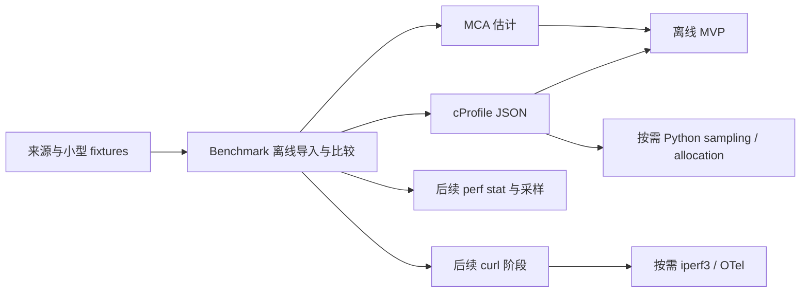

# Profiler 分阶段实施与验收

状态：实施计划，2026-10-30；本 MR 仅交付设计。数据与比较合同见
[profiler 设计](profiler.md)。以下 CLI 是拟议接口，当前尚未实现、不可据此认为工具已可用。

## 首个可用交付：P01

在新的独立 `devtools/profiler/` 下提供 `wjr_profiler` Python package，最低 Python 3.10，
仅使用标准库；不改变 WJR library target、安装导出或 `include/wjr`。
分析机只需原始 JSON 与 manifest，不安装 Google Benchmark、编译器或其他采集工具。

```sh
# 拟议入口；P01 实现后的运行方式由工具 README 固定。
python -m wjr_profiler import --provider google-benchmark \
  --raw baseline.json --manifest baseline.manifest.json --out baseline.bundle
python -m wjr_profiler import --provider google-benchmark \
  --raw candidate.json --manifest candidate.manifest.json --out candidate.bundle
python -m wjr_profiler compare baseline.bundle candidate.bundle --out report
```

输出 `report/report.json` 与 `report/report.md`。exit 0 表示成功生成报告，包括
inconclusive/failed observations；exit 2 表示参数、schema、raw hash 或损坏输入错误。
exit 3 留给后续显式 collector 的进程失败。MVP 不提供性能回归 fail exit code。
输出目录已存在时默认失败，原始 artifact 不覆盖；重建规范化数据使用显式新目录。

P01 本身是独立可用工具，不等待 MCA、网络、采样或远端采集。P01 + P02 + P03 才是
本设计的 MVP；P04 以后的 provider 不阻塞这三项。



## P00：真实 fixture 与来源清单

与 P01 并行准备小型、可分发的 `tests/fixtures/` 和生成记录。每份包含 provider/version、
OS、argv 数组、源/汇编哈希、原始字节哈希、生成环境及真实/synthetic 标记；不复制上游整套测试。
synthetic fixture 可覆盖格式错误，不能被展示为性能证据。

首批清单：

- Google Benchmark v1.9.0：iteration/aggregate 同存、仅 aggregate、error/nonfinite。
  可复用已有 [B+ tree 基线](../performance/btree-baseline.md) 的实际输出，另补 semantic manifest；
  不从 benchmark 名字自动猜输入合同或把原始缺失字段填成已知值。
- LLVM-MCA 18.1.8：多 region、资源块汇总与指令行；原格式探针不等于完整生产 fixtures。
- CPython 3.12.7：两文件同名函数、递归、极小耗时及 caller edges；原同名探针先作证据，
  exporter 交付时补可重建的正式记录。

P01 交付前至少有一份真实 v1.9.0 fixture 和生成记录；fixture owner 不同时改公共 model。

## P01：Google Benchmark 离线对比

范围：`wjr_profiler/{__main__,model,bundle,compare,report}.py`、
`adapters/google_benchmark.py`、对应测试与工具 README。公共 model 由此任务统一维护，
后续 provider 只增加实际用到的适配字段，不预建通用插件框架。

实现内容：

1. 少量明确的 manifest/observation 校验；raw 原样复制并校验 SHA-256，保留 JSON pointer。
2. 解析已验证 v1.9.0 JSON 的 context、原始 repetitions、aggregate、error；单位转换为明确的
   ns/iteration，CPU time 与 wall time 分列。user counter 在单位/flags 未解释前只展示。
3. 先判共同 semantic contract、workload、单位、计时 scope、并发、插桩和环境资格，
   再计算绝对/相对差。revision/variant 可不同；未知关键字段为 inconclusive。
4. 保留原始实验层级；benchmark 内 iterations 不是独立重复。默认 median、min/max、MAD，
   `n >= 2` 时给 sample stddev；无样本则 variance=null。推荐至少七次独立运行，
   基础样本门槛五次；不由五次范围宣称置信区间或统计显著性。
5. 同一个内存模型渲染排序稳定的 JSON/Markdown；不请求网络、不执行 artifact 内命令。

验收重点：

- 一组真实 WJR scan/B+ tree 或极小 Benchmark 输出，两个变体有显式共同合同；
  每个报告指标可追到 raw，离线重导入不依赖原可执行文件。
- iteration + aggregate 不重复统计；only-aggregate 明示样本不足；ns/us 转换准确；
  error 行、missing、NaN/Infinity、空输入、损坏 JSON 与坏 hash 有明确诊断。
- n/hit/alignment、CPU/core class、flags、时钟、scope 或插桩冲突能说明原因；
  baseline=0 不除零。不同机器仅可给 contextual delta，不作为同环境回归门禁。
- Linux/Windows 的离线 smoke 和标准库单元测试通过；无采集工具环境仍可读 fixtures。
  同输入重复生成稳定，输出能用严格标准 JSON 重新读取且无非有限数字。

验证命令拟为 `python -m unittest discover -s devtools/profiler/tests`。
不纳入自动统计显著性、复杂度推断、任意 counter flags 或自动零开销认证。

## P02：LLVM-MCA JSON 与汇编关联

依赖 P01 的 bundle/report；可提前准备 fixtures。首个格式为已运行的 LLVM 18.1.8，
新版本通过 fixture 才扩支持；未知版本只允许 exploratory 输出。
范围是 `adapters/llvm_mca.py`、小型 MCA fixtures 和工具 README。

保留 `CodeRegions` 的名称、序号和汇编顺序，解析实际用到的 Summary、InstructionInfo、
ResourcePressure、TargetInfo、SimulationParameters；区分资源汇总与指令行。
强制标为 `estimate`，不将分析机 CPU 当作 target/model，不融合 P01 的 runtime 测量评分。

```sh
# Producer 命令示例；完整版本、输入、argv、stdout/stderr 与退出状态写入 manifest。
llvm-mca -mtriple=x86_64-unknown-linux-gnu -mcpu=skylake \
  -iterations=100 -json region.s > mca.json 2> mca.stderr
```

验收：两条静态指令、100 次模拟迭代、200 条模拟总指令不混淆；`TotalCycles/Iterations`
与 `BlockRThroughput` 分列。`InstructionIndex=2` 的块汇总不能变成第三条指令。
跨 model/version 的资源索引不直接比较；多 region、缺 marker、unsupported instruction、
失败/部分输出和缺版本均有 fixtures。Linux GCC 与 Clang 的明确 region 各生成一份真实 JSON，
Windows 可离线读取；无本机 MCA 仍可导入。现有 Windows 格式探针不代替这些采集验收。

不实现任意汇编的自动语义 region 提取、文本依赖图猜测或 cache/branch/runtime latency 模拟。

## P03：cProfile JSON，完成 MVP

依赖 P01，与 P02 相互独立。范围是 `exporters/cprofile_json.py`、
`adapters/cprofile_json.py`、小型程序、测试和 README。
分析器读取 `wjr.cprofile-json/1`；producer exporter 先验收 CPython 3.12.7，
其他 3.12.x 也必须各自验证其内部映射，不能声明通用 `.prof` 协议。

拟议 producer 操作是 `python -m cProfile -o own.prof program.py`，然后显式执行
`export-cprofile --input own.prof --output profile.json`。只在匹配的 producer 上转换自有
`.prof`；分析机只接收 JSON。记录 interpreter/build/timer 与线程覆盖，保留
`(file,line,name)`、primitive/total calls、未舍入 self/cumulative 和 caller edges。
不用会覆盖同名函数并舍入时间的 `get_stats_profile()` 作为 exporter。

验收：两文件同名项都保留，递归调用数准确，极小耗时不截为零，cumulative 不逐行求和。
单次 profile 只诊断热点，明示没有运行间方差；跨 revision 的函数关联用显式 region map。
跨解释器/插桩模式不作为 benchmark 门禁；纯 JSON 离线导入不需要执行用户程序。
不实现跨版本 marshal 读取、native 栈分解、Python/C++ 速度排名或完整 async 时间归属。

## 后续 provider：按问题逐项验收

| 阶段 | 最小独立交付 | 验收与推迟边界 |
| --- | --- | --- |
| P04a perf stat | 固定实际 distro perf 与字段，仅本人命令的明确 user-space scope；按硬件支持选 cycles/instructions/branches/branch-misses | 记录 PMU、权限、filters、time enabled/running、缩放/复用、affinity/core type；not counted/unsupported 不补零。whole-process counters 不能分摊成 kernel per-call |
| P04b perf record | 有真实热点问题后保留 perf.data，由匹配版本的 perf script 导出所需字段 | 记录 build-id、符号与 lost samples；不自写 perf.data decoder、不全系统 attach 或自动提权 |
| P05 curl | 对固定 8.10.1 的实际输出导入/显式采集，单次 HTTP/1.1，无 retry/redirect/proxy/reuse，JSONL 一请求一条 | 受控 localhost fixture 区分首字节等待与流式尾部；失败/partial/HTTP2/复用/负差保留诊断。当前 8.11.1 版本探针不算 8.10.1 请求验收 |
| P06a py-spy | 固定 0.4.0 和实际 CPython，只导入一种 speedscope sampled 格式 | 记录 weights/rate/thread/GIL/idle/native/lost；busy/wait fixture 解释归属。无权限仍可离线导入，不自动安装其他采样器 |
| P06b allocation | 复用独立 MemoryManager/自有 allocator 计数 pass，精确分配、采样字节、RSS 分开 | 证明 hook coverage 与扰动；需要 Python memory/copy 再验收 Scalene。敏感 relocate/move 用受控计数、traits 和汇编补证，不全局替换 new |
| P07a iperf3 | 固定 3.17.1 的 JSON，记录 sender/receiver、方向、协议、并发、omit、zerocopy | 自有或已授权两端的真实传输问题；不从 HTTP 延迟推导链路吞吐、不自动发现/部署服务器 |
| P07b OTel | 为实际 SDK/proto/exporter 单独固定版本，只导入一种实际文件 | spec 1.37.0 不是 SDK/OTLP 格式验收。trace/span 因果关系与 clock uncertainty 分列，跨机时间线/独占时间算法另作设计审查 |
| P08 ETW/WPA | 真实需求下固定 ADK、导出命令/profile、表头、单位、locale，保留 ETL 并读官方导出表 | ADK 许可、版本、权限与 exporter 均未验收；不建通用 ETL decoder、不增 Windows 编译矩阵 |

Tracy 仅是 zone、锁或跨语言时间线需求的候选；接入时固定 capture/export 子集，
验证插桩开关成本和权限，不复制其 UI/daemon。ARM/iOS 暂后置，获得实际设备、
工具链和用户 workload 后再建立一张独立 provider 卡，不预排虚构日期。

## 完成标准

每项实现包含最小可用命令、支持/不支持表、fixture 来源和针对性测试。
离线 Python 工具运行最小测试；若新增 C++ producer，则按仓库要求构建对应 target 并跑
clang-format。不为文档或离线 parser 扩充 Windows 矩阵或全平台 benchmark。

MVP 完成要求：没有采集工具的 Windows/Linux 机器可从固定 fixtures 重建三个格式的
JSON/Markdown，能拒绝不兼容合同/单位/环境，并逐项追到 raw。
采样、PMU、网络、ETW 与 ARM 能力各需自己的真实证据；不会由离线 MVP 自动获得支持标记。
