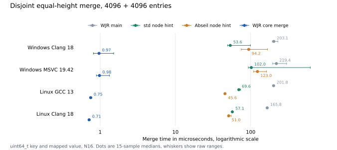

# 普通 merge 的 disjoint graph 路径

普通 `btree_map/set/multimap/multiset::merge` 自动复用相同 traits、标准 `less/greater` 排序、严格不交叠且等高的合适 heap 图。
它与显式 append 共用一个内核，支持 source 位于 destination 前后两个方向。allocator 实例保留，source 为空且可重用。
SSO、自定义 comparator 和其他形态沿用既有元素转移逻辑。experimental compact 的普通 merge 沿用其原选择策略。
[拼接协议](../design/btree-disjoint-append.md)定义占用、生命周期和 hook 可观察状态。

## 固定操作区间

输入按键递增构造，destination 从0开始，source 从8192开始。key 为 uint64_t，mapped 为 uint64_t 或64B array，容量 N16，使用 std::allocator。
计时覆盖 merge，构造和销毁排除。现有 `btree_merge.cpp` 原样用于 main/candidate，固定32次迭代、每进程5个 raw 重复，交替顺序3轮，每项15个样本。
图为 u64 map 的中位数及 raw 范围，横轴为对数。短图操作包含 harness 底噪，倍数对应上述操作区间。
std/Abseil 的成熟对照同时包含普通 merge 和合法的逐节点 extract+end-hint。

| Profile | main us | core merge us | std node hint us | Abseil node hint us |
|---|---:|---:|---:|---:|
| Windows Clang18 | 203.091 | 0.966 | 53.584 | 94.175 |
| Windows MSVC19.42 | 219.428 | 0.978 | 101.991 | 123.016 |
| Linux GCC13 | 201.752 | 0.748 | 69.618 | 45.568 |
| Linux Clang18 | 165.806 | 0.713 | 57.062 | 51.032 |

4096+4096 的普通 legacy merge 在两种 mapped 下比原实现快169�C270倍，比同机最强 std/Abseil 路径快51�C104倍。
150+150 比原实现快5.8�C7.0倍，比最强成熟路径快3.4�C7.1倍。全部大型 core/main raw 交叉包络上界低于0.022。
分片构造成本、长期混合操作吞吐和单独 SSO 计时超出本次计时集合，SSO 正确性包含于边界测试。
不同高度的4096+64保持逐元素路径，其操作计时仍为最强成熟路径的1.59�C2.71倍。

## 完整控制

下表为 candidate/main 中位比值。empty 为4096元素进入空目标，interleaved/conflicting 为4096+4096，sparse 为64元素进入4096目标且均冲突。
普通 legacy 是本轮自动路径的支持域。所有 WJR 参照 comparator、std、Abseil、raw 轮次及交叉包络都保留在同页链接的数据中。

| 普通 legacy 控制 | Windows Clang | Windows MSVC | Linux GCC | Linux Clang |
|---|---:|---:|---:|---:|
| u64 empty | 1.068 | 1.028 | 0.990 | 0.995 |
| u64 interleaved | 1.027 | 0.968 | 1.006 | 1.004 |
| u64 conflicting | 0.924 | 1.005 | 0.957 | 0.993 |
| u64 sparse | 1.031 | 0.988 | 0.987 | 0.983 |
| 64B empty | 0.979 | 1.068 | 0.999 | 0.985 |
| 64B interleaved | 0.962 | 0.978 | 1.011 | 1.007 |
| 64B conflicting | 0.830 | 1.038 | 1.014 | 0.982 |
| 64B sparse | 1.056 | 0.961 | 0.996 | 1.033 |

Windows empty 的中位偏移最高约+6.8%，轮间方向及幅度变化明显。MSVC64B conflicting 为+3.8%，三轮约+4.6/+3.0/+3.8%。
Linux 普通控制最高为 Clang64B sparse 的+3.3%，GCC64B conflicting 为+1.3%。这些小幅成本和轮间不确定性随 raw 数据保留。

| experimental compact 控制 | Windows Clang | Windows MSVC | Linux GCC | Linux Clang |
|---|---:|---:|---:|---:|
| u64 empty | 1.038 | 1.073 | 1.011 | 1.006 |
| u64 interleaved | 1.014 | 0.941 | 0.998 | 0.992 |
| u64 conflicting | 1.077 | 1.068 | 1.006 | 0.944 |
| u64 sparse | 1.010 | 1.038 | 0.985 | 0.902 |
| 64B empty | 1.024 | 1.005 | 1.012 | 0.992 |
| 64B interleaved | 1.004 | 0.983 | 0.977 | 0.997 |
| 64B conflicting | 0.989 | 1.175 | 0.991 | 0.990 |
| 64B sparse | 1.101 | 1.040 | 0.930 | 1.003 |

compact 的最小 ordinary-merge 调用闭包在 Windows Clang/MSVC 中分别有8/12个可达函数，机器码与 main 一致。
上表覆盖完整 benchmark 二进制及其布局影响，Windows64B compact conflicting 中位1.175，三轮1.084/1.368/0.972。
等码检查的范围为上述闭包，完整二进制控制的偏移也保留。

## 节点请求与代码成本

四 profile 的 legacy4096+4096 均由512/511次节点分配/释放降为0/1，150+150由20/17降为1/0。
所有独立计数行销毁后 live requested bytes 为0。graph 路径保留值对象和叶节点，额外 typed 工作区 N16 为536B。
Windows 独立 join 栈帧为680B，普通 merge 栈帧仍为 Clang152B/MSVC184B。
普通 caller 指令由123/139条变为124/143条，workspace 由独立内核承担。
Windows merge benchmark TU 的 `.text` 分别为178727→182503B（Clang，+2.1%）及236006→239470B（MSVC，+1.5%）。

开发中舍弃了在公开 merge 保留 root gate 的版本，其 GCC64B conflicting 为+15.9%。
提取 elementwise wrapper 的版本仍为+13.4%，并使 sparse 增至+22�C29%。最终代码将全部 eligibility 放入既有共享内核，公开入口保留一次调用。
两轮失败记录及原始输出可分别追溯至[原 root-gate 研究](https://github.com/wjr-z/wjr/actions/runs/43576634036)和[fallback wrapper 研究](https://github.com/wjr-z/wjr/actions/runs/43577967529)。

## 来源与正确性

- main 为 `c69cdbbf370009c8419ea3ef8507d6e48754cbfb`，冻结功能源为 `4732ea4f37ff052ae7cb9a5162fc7bcdfe2d979b`。
  最终 `btree.hpp` 恢复 main 原有的无 EOF newline 形态，预处理 token 相同。其余生产、测试及 benchmark blob 一致，两个 SHA-256 集合均记录于数据文件。
- Windows i5-13500HX、CPU0亲和性、Clang18.1.8/MSVC STL、MSVC19.42；Linux 同一 Ubuntu24.04 worker、Intel Xeon6975P-C，GCC13.3/Clang18.1.3、系统 libstdc++，runner 默认亲和性。
  各自为 C++20 Release/baseline，相同 profile 内比较，保留源码、编译器、flags 和 exe provenance。
- Abseil 为干净的 `2a2d6aad626f75a32c8b7bb775fbff73d558b8b1`，复用既有 benchmark option 和 target。
- Clang18完整897项单测、11项 unit CTest、MSVC26项 merge/join 测试和全量 clang-format 通过。
  Linux ASan+UBSan26项通过，覆盖双向边界 shape、N4/5/16/64、透明/非透明 less/greater、SSO、内部重复、stateful comparator、PMR、immovable/align64 值、allocator身份、hook公开状态及source重用。

[完整 raw、内存行、源码 hash、callee 等码和编译 provenance](data/btree-disjoint-merge.json)永久保留本轮数据。
[最终 Linux run](https://github.com/wjr-z/wjr/actions/runs/43578777474)保留编译命令、反汇编、stack-usage和 sanitizer 输出。
复现使用既有 `btree_merge`、`btree_join` 及对应 `_memory` target，构建选项与[显式 append 的重现步骤](btree-disjoint-append.md#正确性与重现)一致。
