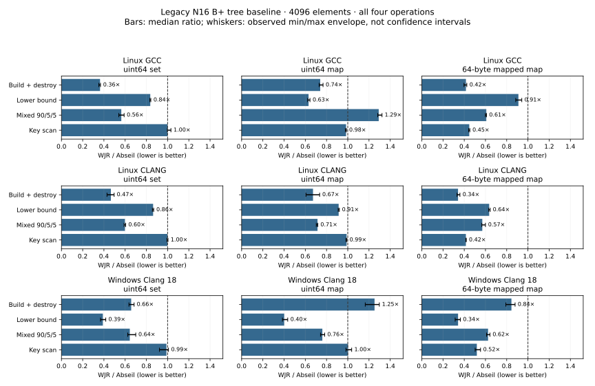
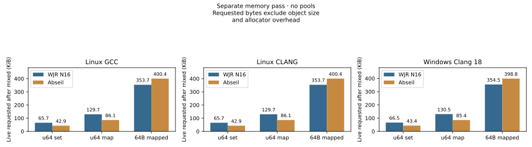

# Legacy B+ tree baseline against Abseil

This report compares WJR's existing N16 B+ tree with Abseil, a mature high-performance
ordered-container implementation. It is a baseline for further layout work. Abseil
is a strong practical comparison, not a claim that one library is fastest for every
ordered-container workload.

[Abseil's design notes](https://abseil.io/about/design/btree) explain its cache and
per-node memory optimizations, along with large-value movement costs and the lack
of pointer/iterator stability. Those tradeoffs motivate this comparison; the
charts below are our measurements rather than numbers copied from that document.

The fixed selection is 4096 elements, integer set, integer map and a map with a
64-byte mapped value. Every selected group includes build + destroy, lower bound,
mixed updates and key scan; ties and losses remain visible beside wins. Byte-budget,
pool and compact candidates are outside this initial comparison.

## Wall-clock time



A ratio below 1 means WJR took less wall-clock time in that profile. Each bar is
`median(WJR) / median(Abseil)`. Whiskers span `min(WJR) / max(Abseil)` through
`max(WJR) / min(Abseil)`: an observed envelope from five samples, **not a confidence
interval**. The [full numeric table](assets/btree/btree-samples.md) retains each
backend's median and min/max. Near-equal results are not evidence of an improvement.

Set build + destroy ratios are 0.36 on Linux GCC, 0.47 on Linux Clang and 0.66 on
Windows Clang. The complete set also retains losses: integer map mixed updates
cost about 1.29 times Abseil on Linux GCC, while Windows integer map build + destroy
costs about 1.25 times Abseil. Small-value key scans are effectively tied. These
observations are specific to the measured workloads and toolchains; they do not
establish a universal ranking or choose a new default layout.

## Requested memory



These are live requested bytes after the mixed trace in a **separate counting
allocator pass**. The [numeric table](assets/btree/btree-samples.md) also reports
peak requests and allocation counts. Counts cover build and mixed mutation;
clear/destruction add deallocations. Every selected pass balances allocations and
deallocations and returns requested live bytes to zero after destruction.

The chart excludes the container object's own size, allocator metadata, size-class
rounding, RSS and committed pages. Object/iterator sizes remain in the compact
source JSON. All selected keys are integers and mapped values own no external
buffers. There are no pools; reserved pool memory is `NA`. This chart must not be
read as process memory consumption or timing instrumentation overhead.

For the Linux profiles, WJR requests 65.7 KiB versus Abseil's 42.9 KiB for the set,
and 129.7 versus 86.1 KiB for the integer map. For the 64-byte mapped case the totals
are 353.7 versus 400.4 KiB. Thus the time advantage on some workloads comes with
visible memory tradeoffs; fewer allocation calls alone would not establish a win.

## Contract and provenance

- `set<uint64_t>`, `map<uint64_t,uint64_t>` and
  `map<uint64_t,array<byte,64>>`, with value-initialized mapped values.
- WJR N16 and public Abseil B-tree containers use `std::less<>` and correctly
  rebound `std::allocator` during timing. Memory counters are absent from timing.
- Shuffled insertion order and queries are generated before timing. The same
  seed, data and trace are used **within a compiler/STL profile**. `std::shuffle`
  may differ across STLs; cross-platform traces are not asserted identical.
- Build includes empty-container construction, insertion and destruction. Lookup
  uses `lower_bound`: 50% of query **keys exist**, which does not mean 50% return
  `end()`. Before-first and after-last misses are included.
- Mixed replays contain 90% lookup, 5% insertion and 5% iterator deletion, including
  the search for that iterator and the shared validity branch. Each replay starts
  from fresh state; its setup and destruction are excluded from the timed region.
- Scan consumes keys and a digest; it does **not read mapped payloads**. The
  64-byte case measures the effect of storage layout on key traversal, not mapped
  payload throughput. No reference/iterator survives mutation, accommodating the
  different invalidation guarantees. Successful operations are compared.
- CPU, OS, compiler, STL, flags, allocator, WJR source, Abseil source and trace-source
  hash are in the compact input. Hardware performance counters were not collected.

| Profile | CPU | Compiler / STL | Configuration | Evidence |
| --- | --- | --- | --- | --- |
| Linux GCC | AMD EPYC 9V74 | GCC 13.3.0 / libstdc++ 20240904 | Release, C++20, baseline, `-O3 -DNDEBUG -march=x86-64` | [Five selected samples](data/btree-linux-gcc13.json), [full workflow artifact](https://github.com/wjr-z/wjr/actions/runs/41044046644) |
| Linux Clang | Same EPYC 9V74 worker | Clang 18.1.3 / libstdc++ 20240908 | Same baseline flags | [Five selected samples](data/btree-linux-clang18.json), [full workflow artifact](https://github.com/wjr-z/wjr/actions/runs/41044046644) |
| Windows Clang 18 | Intel Core i5-13500HX | Clang 18.1.8 / MSVC STL 143.202408 | Release, C++20, baseline, `/O2 /Ob2 /DNDEBUG` | [Five selected raw samples and memory rows](data/btree-windows-clang18.json) |

All measurements are from 2026-10-30. Linux uses WJR source
`6d2d46c2dd731ed2a6dbd5120af49863e834ae46`; Windows uses
`d9c4db33bbdc235fae0b296d472476d8f9edca41`. Both use Abseil
`2a2d6aad626f75a32c8b7bb775fbff73d558b8b1` and the same benchmark source hash.
The Windows minimum duration is 0.01 seconds per repetition; Linux uses 0.05.
Linux's two compiler profiles run sequentially on the same worker, with separate
build/dependency binary directories. Windows uses different hardware. Read each
candidate/reference ratio within its own profile; the comparison does not isolate
OS effects or equate absolute times across machines.

The compact JSON retains the selected five raw samples and memory rows, plus
SHA-256 identifiers for the original full timing/memory files. Linux full outputs
and compile commands are in the linked 90-day artifact; the checked-in compact
data remain available after it expires. Windows full raw files are local, with
the selected evidence retained publicly in the JSON. Historical raw campaigns
and vendor sources are not copied into this repository.

## Reproduce

The specialized flow is disabled by default and has no push/PR/schedule trigger:

```sh
gh workflow run benchmarks.yml --ref <reviewed-branch> -f showcase=true
```

The explicit manual entry calls `btree-showcase.yml`: one Ubuntu 24.04 worker
measures GCC 13 and Clang 18 sequentially, checks out the reviewed Abseil commit,
runs five repetitions and a separate memory pass, then uploads `btree-showcase`.
No vendor source is published in that artifact. The regular scheduled `core`
profile and existing Windows matrix retain their previous behavior.

To regenerate the checked-in charts from the compact evidence:

```sh
python -m pip install matplotlib==3.11.1
python benchmarks/tools/btree_showcase.py render \
  docs/performance/data/btree-linux-gcc13.json \
  docs/performance/data/btree-linux-clang18.json \
  docs/performance/data/btree-windows-clang18.json \
  --output-dir docs/performance/assets/btree
python -m unittest discover -s benchmarks/tools -p test_btree_showcase.py
```

The script also accepts `--format png`. Its `collect` command extracts only this
fixed selection from the benchmark JSON and memory CSV; it rejects missing Abseil,
incomplete repetition sets, incompatible compiler/STL/flags and unbalanced memory
passes. `render` consumes those collected compact inputs; it is not a general
benchmark-data validation interface. See the workflow for the exact collection/build commands and
[the baseline methodology](btree-baseline.md) for the executable's larger input set.
